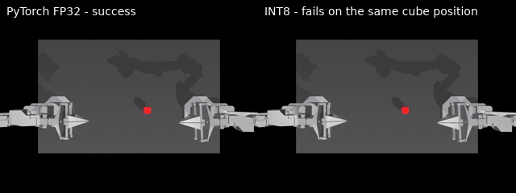
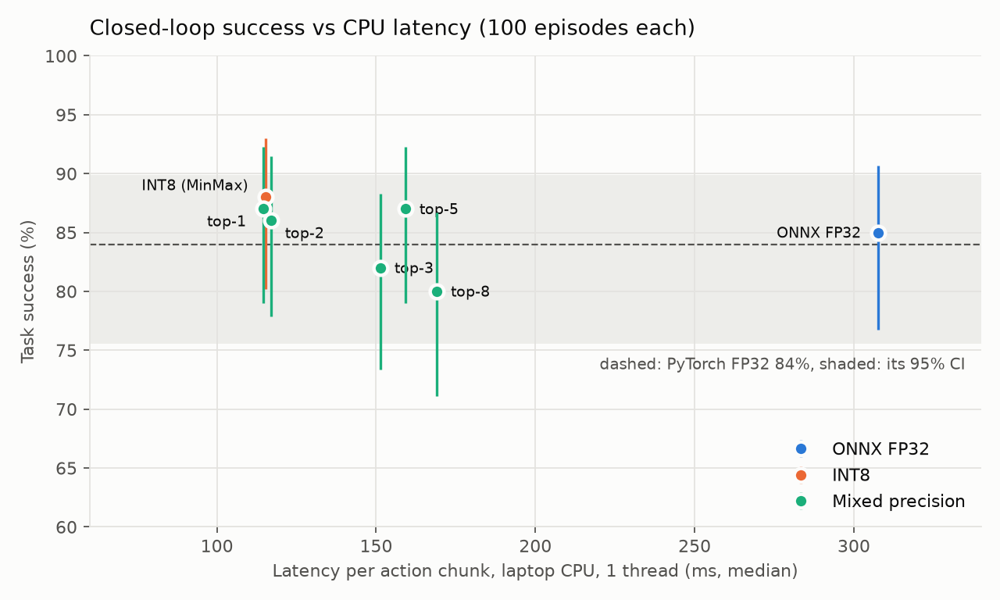
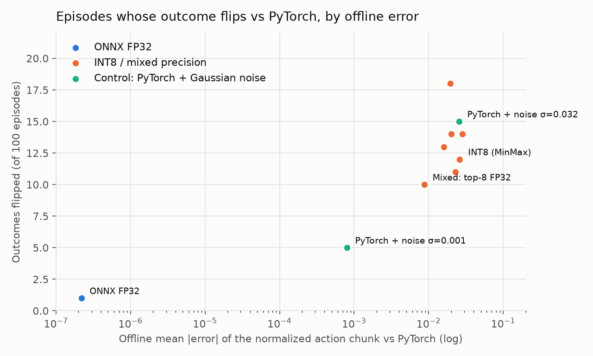

# ACT Policy: Closed-Loop Quantization Study

Does an INT8 robot policy that matches its FP32 outputs offline also behave the same when it actually
controls the robot? This project trains an [ACT](https://arxiv.org/abs/2304.13705) policy on LeRobot's
simulated ALOHA transfer-cube task, exports it to ONNX, quantizes it to INT8 with ONNX Runtime and
compares offline action error, laptop CPU latency and **closed-loop task success**. It then uses
per-layer sensitivity analysis to build mixed-precision variants.



*Same cube position (seed 2000), same checkpoint. Left: PyTorch FP32 completes the handover. Right:
INT8 (Percentile calibration) drops the cube. Over 100 episodes the two have the same success rate.*

## Findings

1. **INT8 costs no task success.** On 100 fixed cube positions, PyTorch FP32 succeeds 84 times and
   INT8 88 times (95% CIs 76–90 and 80–93). The model is 3.8× smaller and 2.2–2.7× faster on a laptop CPU.
2. **INT8 does change behaviour: 12–14 of 100 episodes flip outcome** relative to PyTorch (some fail
   → succeed, some succeed → fail). The flips cancel in the average, so the success rate alone hides them.
3. **The flips are a property of the task, not of quantization.** Adding Gaussian noise of the same
   size as INT8's error to the PyTorch actions flips 15 episodes; even noise 30× smaller flips 5.
   Exported ONNX FP32 (error ~1e-7) flips 1.
4. **Lower offline error did not buy closed-loop agreement.** Keeping the 8 most sensitive layer
   groups in FP32 cuts mean action error 3× (and worst-case error 3.4×) but still flips 10 episodes,
   and is 34–47% slower than full INT8 (4 / 1 threads).
5. **Sensitivity is concentrated in attention and the ends of the network.** Quantized one group at a
   time, the action head, the decoder cross-attention, the backbone stem and every self-attention
   block cause roughly 10× more error than the feed-forward blocks.

Takeaway: for this policy, an offline parity check (mean cosine 0.999) correctly predicts the
*aggregate* success rate, but neither it nor the success rate tells you that individual rollouts
diverge. Comparing per-episode outcomes on fixed seeds, against a noise control, does.

## Results

Checkpoint: step 40k of a 100k-step run (chosen on seeds 1000–1049, see [Training](#training)). Every
row runs on the same 100 cube positions (seeds 2000–2099) with the policy network on CPU; only the
network differs. "Flipped" counts episodes whose success/failure differs from PyTorch FP32
(+ gained, − lost). Offline error: mean absolute error of the normalized 100-step action chunk vs
PyTorch on held-out dataset frames.

| Variant | Size (MB) | Laptop latency, 4 thr / 1 thr (ms) | Offline mean abs error | Success /100 (95% CI) | Outcomes flipped vs PyTorch |
|---|---|---|---|---|---|
| PyTorch FP32 | — | — | 0 (reference) | **84** (76–90) | — |
| ONNX FP32 | 137 | 179 / 308 | 2.2e-07 | **85** (77–91) | 1 (+1 / −0) |
| INT8 (MinMax) | 36 | 82 / 115 | 2.6e-02 | **88** (80–93) | 12 (+8 / −4) |
| INT8 (Percentile) | 36 | same graph as MinMax | 2.8e-02 | **88** (80–93) | 14 (+9 / −5) |
| Mixed: top-1 FP32 | 36 | 82 / 115 | 2.3e-02 | **87** (79–92) | 11 (+7 / −4) |
| Mixed: top-2 FP32 | 39 | 83 / 117 | 2.0e-02 | **86** (78–91) | 14 (+8 / −6) |
| Mixed: top-3 FP32 | 39 | 98 / 151 | 1.9e-02 | **82** (73–88) | 18 (+8 / −10) |
| Mixed: top-5 FP32 | 43 | 106 / 159 | 1.6e-02 | **87** (79–92) | 13 (+8 / −5) |
| Mixed: top-8 FP32 | 52 | 110 / 169 | 8.7e-03 | **80** (71–87) | 10 (+3 / −7) |
| Control: PyTorch + noise σ=0.001 | — | — | 8.0e-04 | **83** (74–89) | 5 (+2 / −3) |
| Control: PyTorch + noise σ=0.032 | — | — | 2.6e-02 | **83** (74–89) | 15 (+7 / −8) |





Mixed "top-k" keeps the k layer groups with the highest single-group error in FP32. Ranking (MinMax
calibration): action head, decoder cross-attention, backbone stem, backbone layer1, then encoder
self-attention layers 3, 2, 1, 0. Full numbers: [`results/summary.json`](results/summary.json).

Latency: one forward pass (one 100-action chunk, batch 1), Intel Core i7-1355U, ONNX Runtime 1.31.1
CPU, AC power, median of 100 timed runs after warm-up, models interleaved. ACT runs the network once
per 100 control steps (2 s at 50 Hz), so all variants fit that budget; INT8 would matter for temporal
ensembling, which queries the network every step.

## Method

**Training.** <a id="training"></a> LeRobot 0.6.1 ACT (ResNet-18 backbone, 4 encoder / 1 decoder
layers, chunk size 100) on `lerobot/aloha_sim_transfer_cube_human` (50 human demos), 100k steps, batch
8, lr 1e-5, one RTX 4000 Ada GPU, 3 h 16 min. 50-episode evals on seeds 1000–1049: step 40k 76%, step
100k 66%, LeRobot's published checkpoint 70% (same setup). Step 40k was selected there and then
re-measured on fresh seeds 2000–2049 (90%) and 2000–2099 (84%, the table above). The 76% vs 90% gap for
one checkpoint across two 50-position sets is why the comparison uses 100 episodes on fixed seeds.

**Export** ([`act_onnx/export.py`](act_onnx/export.py)). Only the inference network goes to ONNX
(backbone + transformer, VAE latent fixed at zero, opset 17, dynamic batch). LeRobot's normalization
and action queue stay in Python, so every variant sees identical inputs. FP32 parity on 500 held-out
frames: max abs error 4.9e-6, min cosine 0.9999998.

**Quantization** ([`act_onnx/quantize.py`](act_onnx/quantize.py)). ONNX Runtime static QDQ, U8
activations / S8 per-channel weights, on Conv, Gemm, MatMul (+ Relu/MaxPool). Calibration: 200
dataset frames disjoint from the parity frames, MinMax or Percentile (99.999).

**Closed loop** ([`act_onnx/eval_closed_loop.py`](act_onnx/eval_closed_loop.py)). Runs `lerobot-eval`
unchanged except that `policy.model` is replaced by an ONNX Runtime session (or wrapped with Gaussian
noise for the control). Same env, seeds, processors, action queue and metrics.

**Sensitivity** ([`act_onnx/sensitivity.py`](act_onnx/sensitivity.py)). Calibrate once (ranges
cached), quantize one of 20 layer groups at a time, measure error vs PyTorch on 200 frames, rank, then
build top-k mixed-precision models.

## Pitfalls hit along the way

- **ONNX Runtime 1.31 MinMax + `CalibMaxIntermediateOutputs`:** the calibrator discards each flushed
  chunk without computing its range. With 200 frames and a chunk of 20 it fails with "No data is
  collected"; with a non-dividing chunk it would silently calibrate on the last few frames only.
  Don't set it.
- **LeRobot 0.6.1 async eval envs** start workers with `forkserver`, which never import `gym_aloha`
  ("Namespace gym_aloha not found"). Use `--eval.use_async_envs=false`.
- **`lerobot-eval` enables TF32 on GPU.** All policies here run on CPU so the FP32 reference is exact.
- **A 50-episode success rate moved 14 points between two seed sets** (76% vs 90%, same checkpoint), so small evals can't rank
  checkpoints or quantization schemes.

## Reproduce

Tested with LeRobot 0.6.1, Python 3.12, CUDA 12.8 PyTorch wheels (NVIDIA driver >= 570); versions in
`requirements.lock.txt`. Jobs run under SLURM: copy `cluster.local.env.example` to `cluster.local.env`
and fill it in.

```bash
CONDA_ROOT=/path/to/miniconda3 bash scripts/setup_env.sh
scripts/submit.sh jobs/train_act.sbatch                                   # train (≈3.2 h)
C=outputs/train/act_transfer_cube_100k/checkpoints/040000/pretrained_model
CKPT=$C SEED=2000 RUN_NAME=40k scripts/submit.sh jobs/eval_ckpt.sbatch    # sim eval of a checkpoint
CKPT=$C scripts/submit.sh jobs/export_parity.sbatch                       # ONNX FP32 + parity
CKPT=$C METHOD=minmax scripts/submit.sh jobs/quantize.sbatch              # INT8 + parity
CKPT=$C RUN_NAME=onnx_int8_minmax ACT_ONNX=outputs/onnx/act_int8_minmax.onnx \
  scripts/submit.sh jobs/eval_closed_loop.sbatch                          # 100-episode closed loop
CKPT=$C METHOD=minmax scripts/submit.sh jobs/sensitivity.sbatch           # sensitivity + mixed models
```

Latency (on any machine, needs only `onnxruntime` and `numpy`) and the report:

```bash
python act_onnx/bench_latency.py --threads 4 --out outputs/latency/laptop_4t.json outputs/onnx/*.onnx
python act_onnx/report.py   # results/summary.json, results/table.md, docs/*.png
```

## Limitations

One task, one seed of training, simulation only. 100 episodes give ±7-point confidence intervals,
so differences between quantized variants are not significant. Latency is from one laptop CPU.
